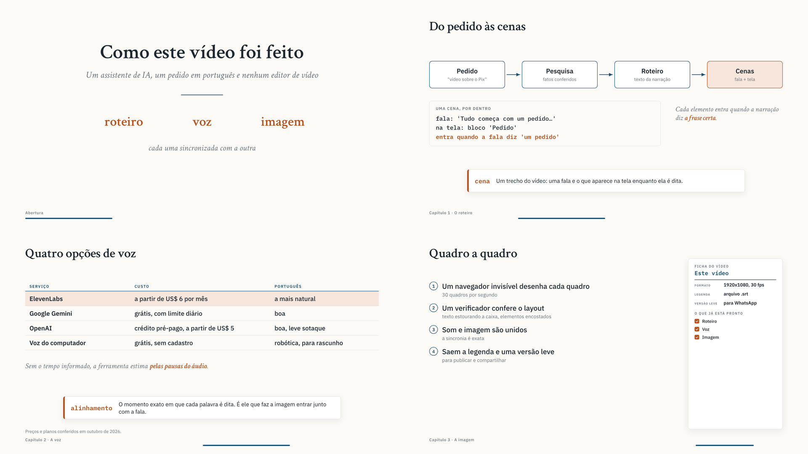

# Skills do Alex Netto

Skills para agentes de IA, em português. Uma skill é um pacote de instruções e ferramentas que ensina o Claude (ou outro agente) a fazer uma tarefa inteira, do começo ao fim, sem você precisar saber programar.

| Skill | O que faz |
|---|---|
| [`video-explicativo`](skills/video-explicativo) | Vídeo narrado sobre qualquer assunto ou pesquisa: roteiro, voz, animação que entra junto com a fala, legenda e versão leve para compartilhar |

## video-explicativo

Você pede: *"Faz um vídeo de 4 minutos explicando como funciona o Pix, para donos de pequenas empresas."*

O Claude pesquisa e confere os fatos, escreve o roteiro em cenas, mostra uma prévia, pede sua aprovação, gera a narração, desenha o vídeo quadro a quadro e entrega:

- o vídeo em alta qualidade (1920x1080, MP4);
- uma versão leve para WhatsApp e redes;
- a legenda (`.srt`) para YouTube e LinkedIn;
- os capítulos para a descrição do YouTube;
- o roteiro em texto.



Na primeira vez, a própria skill instala o que falta no computador e te guia para pegar a chave da voz.

### Vozes

| Opção | Qualidade em português | Custo |
|---|---|---|
| ElevenLabs | a mais natural | US$ 6/mês (o primeiro mês costuma sair por US$ 1) |
| Google Gemini | boa | grátis, com limite por dia, sem cartão |
| OpenAI | boa, com leve sotaque | pré-pago, mínimo de US$ 5 |
| Voz do computador | robótica, para rascunho | grátis, sem cadastro |

## Como instalar

Você precisa do **Claude Code**: o app do Claude para computador, na aba **Code**, ou o Claude no terminal. A skill não funciona no chat comum do claude.ai, porque precisa rodar programas no seu computador.

**Jeito mais fácil:** abra uma conversa na aba Code e cole:

> Instale a skill video-explicativo do repositório https://github.com/alextnetto/skills: clone o repositório e copie a pasta skills/video-explicativo para ~/.claude/skills/video-explicativo.

Depois abra uma conversa nova e peça o seu vídeo.

**Pelo terminal do Claude Code**, como plugin (recebe atualizações):

```
/plugin marketplace add alextnetto/skills
/plugin install video-explicativo@alextnetto
```

**Em outros agentes** (Codex, Cursor e outros):

```bash
npx skills add alextnetto/skills --skill video-explicativo
```

## Como usar

Peça em linguagem natural, dizendo o assunto e, se quiser, o público e a duração:

- "Faz um vídeo explicativo de 3 minutos sobre o que é inflação, para adolescentes."
- "Transforma esse relatório em um vídeo narrado de 5 minutos." (e mande o arquivo)
- "Quero um vídeo explicando o nosso produto para clientes novos, com fundo escuro."

Para ajustar depois: "deixa a voz um pouco mais rápida", "troca a cena 3", "corta o capítulo 2".

## Por dentro

Para quem tem curiosidade: cada vídeo vira uma pasta com o roteiro em JavaScript (`roteiro/`), um motor de animação em que tudo é função do tempo, e ferramentas em Node.

1. A voz narra cada cena e informa o momento exato de cada letra. Quando o serviço não informa (Gemini, OpenAI, voz do computador), a ferramenta estima pelas pausas do áudio. Nos testes, o erro ficou em 0,06 s na metade das palavras e abaixo de 0,3 s em 90% delas.
2. Cada elemento da tela entra quando a fala diz uma frase do roteiro (`at: '@frase'`).
3. Um Chromium invisível (Playwright) desenha cada quadro. Antes disso, um verificador procura texto estourando a caixa e elementos encostados.
4. O ffmpeg junta som e imagem com sincronia exata e gera a legenda a partir dos mesmos tempos.

Detalhes para quem quiser mexer: [`skills/video-explicativo/SKILL.md`](skills/video-explicativo/SKILL.md) e a pasta [`referencia/`](skills/video-explicativo/referencia).

## Licença

MIT. As fontes (Crimson Text e IBM Plex, licença OFL) são baixadas pelo npm na instalação.
